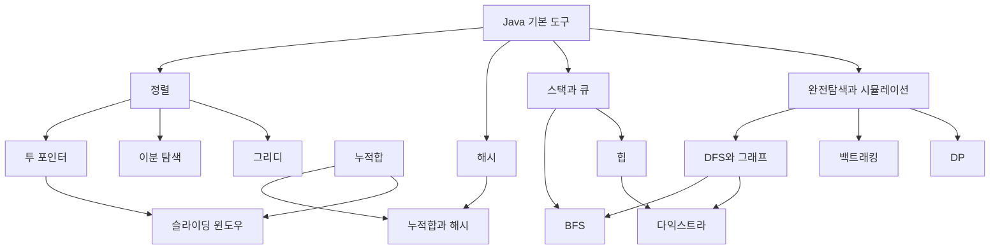

# 그래프 지도

**전체 그래프는 관계를 보고, 학습 순서는 [[01 학습 순서]]를 본다.** 노트마다 `먼저 / 다음 / 비교` 링크를 두어, 단순 태그 모음 대신 실제 학습 관계를 연결했다.

## 바로 쓸 그래프

Obsidian 왼쪽 **북마크 → 학습 그래프**에 다음 보기를 저장했다.

- **핵심 17개:** 핵심 템플릿만 표시한다. 처음에는 이 보기를 쓴다.
- **전체 템플릿:** 확장 주제까지 표시한다. 안내·빈 양식·첨부는 제외한다.
- **구간 집중:** 누적합·투 포인터·윈도우·이분 탐색과 해시를 비교한다.

기본 그래프도 핵심 보기로 맞췄다. 태그 노드·첨부·미해결 링크를 숨기고, Java / 구간 / 탐색 / 최적화 폴더를 다른 색으로 표시한다. 설정 파일을 바꾼 뒤 이미 열려 있는 그래프가 그대로라면, 북마크에서 해당 보기를 다시 연다.

## 연결을 읽는 법

화살표는 공부할 때 도움이 되는 앞선 내용이다. 모든 문제에서 반드시 그 알고리즘을 함께 써야 한다는 뜻은 아니다. 구간 예시부터 이해되는 경우에는 누적합부터 시작해도 된다.

## 현재 노트 주변만 보고 싶을 때

명령 팔레트에서 **로컬 그래프 열기 / Open local graph**를 실행하고 깊이를 1로 둔다. 연결이 너무 많으면 전체 그래프보다 현재 주제와 직접 연결된 노트만 보는 편이 낫다.

새 링크는 **선행 지식 / 함께 쓰는 도구 / 헷갈리는 비교** 중 하나일 때만 추가한다. 같은 분야라는 이유만으로 모든 노트를 서로 연결하지 않는다.

참고: [Obsidian 그래프 공식 도움말](https://help.obsidian.md/Plugins/Graph+view), [검색·속성 필터 문법](https://help.obsidian.md/Plugins/Search)
