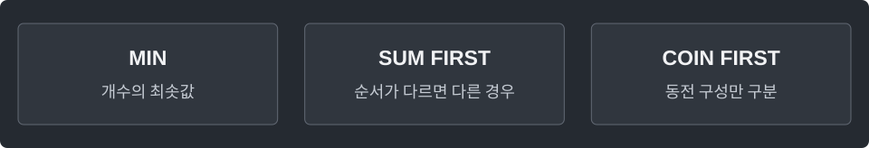

---
tags:
  - dp
cssclasses:
  - algorithm-reference-sample
code-styler-ignore: true
---

# Coin Change

> [!reference] 개념과 사용 조건
> **목적** · 동전을 무제한 사용해 정확히 amount를 만든다.
>
> **조건** · coins는 중복 없는 양의 정수, `amount ≥ 0`. 경우의 수는 `mod ≥ 2`로 나눈다.
>
> **초기값** · 합 0의 최소 개수는 0, 합 0을 만드는 경우의 수는 1.
>
> **비용** · O(coins.length × amount) 시간, O(amount) 공간.

---

## Minimum Count

**Structure**

<pre class="algorithm-code" data-language="text"><code>// dp[0] = 0, 나머지는 불가능
for (작은 합부터) {
    for (쓸 수 있는 각 동전) {
        // 이전 합의 최소 개수 + 1로 갱신
    }
}
return 최소 개수 또는 -1;</code></pre>

**Java**

<pre class="algorithm-code" data-language="java"><code>import java.util.*;

static int minCoins(int[] coins, int amount) {
    int impossible = amount + 1;
    int[] dp = new int[amount + 1];
    Arrays.fill(dp, impossible);
    dp[0] = 0;

    for (int sum = 1; sum &lt;= amount; sum++) {
        for (int coin : coins) {
            if (coin &lt;= sum) {
                dp[sum] = Math.min(dp[sum], dp[sum - coin] + 1);
            }
        }
    }

    return dp[amount] == impossible ? -1 : dp[amount];
}</code></pre>

---

## Ordered Count · 1+2 ≠ 2+1

**Structure**

<pre class="algorithm-code" data-language="text"><code>// dp[0] = 1
for (작은 합부터) {
    for (마지막에 붙일 각 동전) {
        // 그 동전을 붙이기 전 합의 경우의 수 누적
    }
}
return dp[amount];</code></pre>

**Java**

<pre class="algorithm-code" data-language="java"><code>static long countOrdered(int[] coins, int amount, int mod) {
    long[] dp = new long[amount + 1];
    dp[0] = 1;

    <mark class="algorithm-change">for</mark><mark class="algorithm-change"> (</mark><mark class="algorithm-change">int</mark><mark class="algorithm-change"> sum = 1; sum &lt;= amount; sum++)</mark> {
        for (int coin : coins) {    // 마지막 동전이 다르면 다른 순서로 센다
            if (coin &lt;= sum) {
                dp[sum] = (dp[sum] + dp[sum - coin]) % mod;
            }
        }
    }

    return dp[amount];
}</code></pre>

---

## Unordered Count · 1+2 = 2+1

**Structure**

<pre class="algorithm-code" data-language="text"><code>// dp[0] = 1
for (동전 종류를 하나씩 허용하며) {
    for (작은 합부터) {
        // 이번 동전을 추가하는 경우 누적
    }
}
return dp[amount];</code></pre>

**Java**

<pre class="algorithm-code" data-language="java"><code>static long countUnordered(int[] coins, int amount, int mod) {
    long[] dp = new long[amount + 1];
    dp[0] = 1;

    <mark class="algorithm-change">for</mark><mark class="algorithm-change"> (</mark><mark class="algorithm-change">int</mark><mark class="algorithm-change"> coin : coins)</mark> {    // 종류를 고정된 순서로 도입해 순서 중복 제거
        for (int sum = coin; sum &lt;= amount; sum++) {
            dp[sum] = (dp[sum] + dp[sum - coin]) % mod;
        }
    }

    return dp[amount];
}</code></pre>

[[Knapsack DP]]
