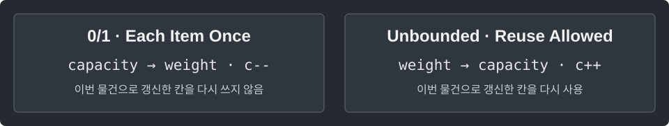

---
tags:
  - dp
cssclasses:
  - algorithm-reference-sample
code-styler-ignore: true
---

# Knapsack DP

> [!reference] 개념과 사용 조건
> **목적** · 용량 이하에서 얻을 수 있는 최대 가치.
>
> **상태** · `dp[c]` = 지금까지 본 물건으로 용량 c 이하에서 얻는 최대 가치.
>
> **조건** · `weight[i] > 0`, `capacity ≥ 0`, weight·value 길이가 같다. 물건을 안 골라도 된다.
>
> **비용** · O(n × capacity) 시간, O(capacity) 공간. 가치 합은 long 범위.

---

## 0/1 · Each Item Once

각 물건을 최대 한 번 골라 용량 이하에서 얻을 수 있는 최대 가치를 구한다.

**Structure**

<pre class="algorithm-code" data-language="text"><code>for (각 물건) {
    for (큰 용량부터 작은 용량으로) {
        // 안 넣기 / 이번 물건 넣기 중 최댓값
    }
}
return dp[capacity];</code></pre>

**Java**

<pre class="algorithm-code" data-language="java"><code>static long zeroOneKnapsack(int[] weight, long[] value, int capacity) {
    long[] dp = new long[capacity + 1];

    for (int i = 0; i &lt; weight.length; i++) {
        for (int c = capacity; c &gt;= weight[i]; <mark class="algorithm-change">c--</mark>) {    // 이번 물건으로 갱신된 작은 용량을 재사용하지 않음
            dp[c] = Math.max(dp[c], dp[c - weight[i]] + value[i]);
        }
    }

    return dp[capacity];
}</code></pre>

---

## Unbounded · Reuse Allowed

같은 물건을 여러 번 골라도 될 때 용량 이하에서 얻을 수 있는 최대 가치를 구한다.

**Structure**

<pre class="algorithm-code" data-language="text"><code>for (각 물건 종류) {
    for (작은 용량부터 큰 용량으로) {
        // 이번 종류를 다시 넣을 수 있는 상태에서 갱신
    }
}
return dp[capacity];</code></pre>

**Java**

<pre class="algorithm-code" data-language="java"><code>static long unboundedKnapsack(int[] weight, long[] value, int capacity) {
    long[] dp = new long[capacity + 1];

    for (int i = 0; i &lt; weight.length; i++) {
        for (int c = weight[i]; c &lt;= capacity; <mark class="algorithm-change">c++</mark>) {    // 같은 물건을 쓴 작은 용량을 다시 이용
            dp[c] = Math.max(dp[c], dp[c - weight[i]] + value[i]);
        }
    }

    return dp[capacity];
}</code></pre>

[[Coin Change]]
