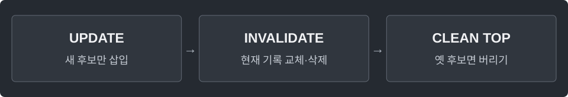

---
tags:
  - data-structures
cssclasses:
  - algorithm-reference-sample
code-styler-ignore: true
---

# Heap with Lazy Deletion

> [!reference] 개념과 사용 조건
> **목적** · ID별 우선순위 갱신·삭제를 지원하는 최소 힙.
>
> **핵심** · Map은 현재 후보, heap에는 옛 후보도 남는다. 객체를 바꾸고 기존 객체는 수정하지 않는다.
>
> **비용** · 삽입·갱신 O(log q), 삭제 Map 평균 O(1). q번 삽입 동안 정리 비용 합계 O(q log q), 공간 O(q).

---

## Template

ID별 항목을 추가·갱신·삭제하고, 현재 우선순위가 가장 작은 항목을 조회하거나 꺼낸다.

**Structure**

<pre class="algorithm-code" data-language="text"><code>put(id, priority) {
    // 새 Entry를 현재 기록과 힙에 저장
}
remove(id) {
    // 현재 기록만 삭제
}
clean() {
    while (top이 현재 기록의 객체가 아니면) {
        // 옛 후보 제거
    }
}
poll() {
    // clean → 최소 후보 제거 → 현재 기록 삭제
}</code></pre>

**Java**

<pre class="algorithm-code" data-language="java"><code>static class Entry {
    final int id;
    final long priority;

    Entry(int id, long priority) {
        this.id = id;
        this.priority = priority;
    }
}

static class LazyMinHeap {
    final Map&lt;Integer, Entry&gt; current = new HashMap&lt;&gt;();
    final PriorityQueue&lt;Entry&gt; heap = new PriorityQueue&lt;&gt;(
            Comparator.comparingLong(entry -&gt; entry.priority));

    void put(int id, long priority) {
        Entry entry = new Entry(id, priority);
        current.put(id, entry);
        heap.offer(entry);
    }

    void remove(int id) {
        current.remove(id);
    }

    void clean() {
        while (!heap.isEmpty() &amp;&amp; current.get(heap.peek().id) != heap.peek()) {
            heap.poll();    // 같은 ID·우선순위로 재삽입돼도 객체가 다르면 옛 후보
        }
    }

    Entry peek() {
        clean();
        return heap.peek();    // 비었으면 null
    }

    Entry poll() {
        clean();
        Entry entry = heap.poll();
        if (entry != null) current.remove(entry.id);
        return entry;
    }
}</code></pre>

[[PriorityQueue]] · [[Dijkstra]]
