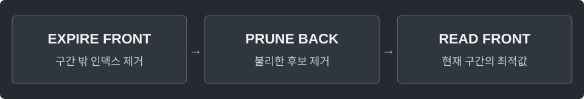

---
tags:
  - data-structures
cssclasses:
  - algorithm-reference-sample
code-styler-ignore: true
---

# Monotonic Deque

> [!reference] 개념과 사용 조건
> **목적** · 길이 k인 모든 연속 구간의 최댓값·최솟값.
>
> **조건** · 1 ≤ k ≤ n. 값 대신 인덱스를 넣어 만료 여부도 판단.
>
> **비용** · 시간 O(n), deque 공간 O(k), 결과 공간 O(n).

---

## Maximum

**Structure**

<pre class="algorithm-code" data-language="text"><code>for (right를 처음부터 끝까지) {
    // 앞에서 만료된 인덱스 제거
    // 뒤에서 현재 값보다 불리한 후보 제거
    // 현재 인덱스 추가
    if (구간 길이가 k이면) {
        // 맨 앞의 값 기록
    }
}</code></pre>

**Java**

<pre class="algorithm-code" data-language="java"><code>static int[] windowMax(int[] a, int k) {
    if (k &lt; 1 || k &gt; a.length) throw new IllegalArgumentException();
    int[] answer = new int[a.length - k + 1];
    Deque&lt;Integer&gt; deque = new ArrayDeque&lt;&gt;();

    for (int right = 0; right &lt; a.length; right++) {
        while (!deque.isEmpty() &amp;&amp; deque.peekFirst() &lt;= right - k) {
            deque.pollFirst();
        }
        while (!deque.isEmpty() &amp;&amp; <mark class="algorithm-change">a[deque.peekLast()] &lt;= a[right]</mark>) {
            deque.pollLast();    // 같은 값이면 더 늦게 만료되는 현재 인덱스를 남김
        }
        deque.offerLast(right);
        if (right &gt;= k - 1) answer[right - k + 1] = a[deque.peekFirst()];
    }
    return answer;
}</code></pre>

---

## Minimum

**Structure**

<pre class="algorithm-code" data-language="text"><code>for (right를 처음부터 끝까지) {
    // 앞에서 만료된 인덱스 제거
    // 뒤에서 현재 값보다 불리한 후보 제거
    // 현재 인덱스 추가
    if (구간 길이가 k이면) {
        // 맨 앞의 값 기록
    }
}</code></pre>

**Java**

<pre class="algorithm-code" data-language="java"><code>static int[] windowMin(int[] a, int k) {
    if (k &lt; 1 || k &gt; a.length) throw new IllegalArgumentException();
    int[] answer = new int[a.length - k + 1];
    Deque&lt;Integer&gt; deque = new ArrayDeque&lt;&gt;();

    for (int right = 0; right &lt; a.length; right++) {
        while (!deque.isEmpty() &amp;&amp; deque.peekFirst() &lt;= right - k) {
            deque.pollFirst();
        }
        while (!deque.isEmpty() &amp;&amp; <mark class="algorithm-change">a[deque.peekLast()] &gt;= a[right]</mark>) {
            deque.pollLast();    // 같은 값이면 더 늦게 만료되는 현재 인덱스를 남김
        }
        deque.offerLast(right);
        if (right &gt;= k - 1) answer[right - k + 1] = a[deque.peekFirst()];
    }
    return answer;
}</code></pre>

[[Sliding Window]] · [[Monotonic Stack]]
