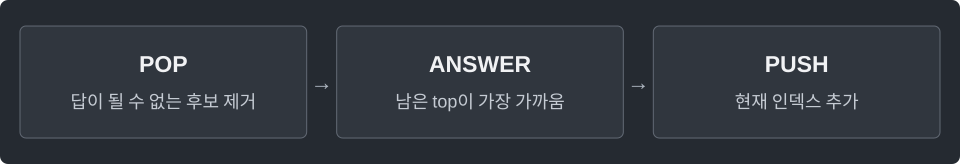

---
tags:
  - data-structures
cssclasses:
  - algorithm-reference-sample
code-styler-ignore: true
---

# Monotonic Stack

> [!reference] 개념과 사용 조건
> **목적** · 각 위치에서 가장 가까운 더 큰 값·작은 값의 인덱스.
>
> **반환** · 답이 없으면 -1. 값이 아닌 인덱스를 스택에 저장.
>
> **비용** · 각 인덱스는 한 번 들어가고 한 번 빠짐. 시간 O(n), 공간 O(n).

---

## Next Greater

오른쪽의 첫 엄격히 큰 값의 **인덱스**.

**Structure**

<pre class="algorithm-code" data-language="text"><code>for (오른쪽에서 왼쪽으로) {
    while (top이 현재 원소의 답이 될 수 없으면) {
        // pop
    }
    // result[i]: 남은 top, 없으면 -1
    // 현재 인덱스 push
}</code></pre>

**Java**

<pre class="algorithm-code" data-language="java"><code>static int[] nextGreater(int[] a) {
    int[] result = new int[a.length];
    Deque&lt;Integer&gt; stack = new ArrayDeque&lt;&gt;();

    for (int i = a.length - 1; i &gt;= 0; i--) {
        while (!stack.isEmpty() &amp;&amp; <mark class="algorithm-change">a[stack.peek()] &lt;= a[i]</mark>) {
            stack.pop();    // 같은 값도 제거해야 엄격한 대소 비교가 됨
        }
        result[i] = stack.isEmpty() ? -1 : stack.peek();
        stack.push(i);
    }
    return result;
}</code></pre>

---

## Next Smaller

오른쪽의 첫 엄격히 작은 값의 **인덱스**.

**Structure**

<pre class="algorithm-code" data-language="text"><code>for (오른쪽에서 왼쪽으로) {
    while (top이 현재 원소의 답이 될 수 없으면) {
        // pop
    }
    // result[i]: 남은 top, 없으면 -1
    // 현재 인덱스 push
}</code></pre>

**Java**

<pre class="algorithm-code" data-language="java"><code>static int[] nextSmaller(int[] a) {
    int[] result = new int[a.length];
    Deque&lt;Integer&gt; stack = new ArrayDeque&lt;&gt;();

    for (int i = a.length - 1; i &gt;= 0; i--) {
        while (!stack.isEmpty() &amp;&amp; <mark class="algorithm-change">a[stack.peek()] &gt;= a[i]</mark>) {
            stack.pop();    // 같은 값도 제거해야 엄격한 대소 비교가 됨
        }
        result[i] = stack.isEmpty() ? -1 : stack.peek();
        stack.push(i);
    }
    return result;
}</code></pre>

---

## Previous Greater

왼쪽의 첫 엄격히 큰 값의 **인덱스**.

**Structure**

<pre class="algorithm-code" data-language="text"><code>for (왼쪽에서 오른쪽으로) {
    while (top이 현재 원소의 답이 될 수 없으면) {
        // pop
    }
    // result[i]: 남은 top, 없으면 -1
    // 현재 인덱스 push
}</code></pre>

**Java**

<pre class="algorithm-code" data-language="java"><code>static int[] previousGreater(int[] a) {
    int[] result = new int[a.length];
    Deque&lt;Integer&gt; stack = new ArrayDeque&lt;&gt;();

    for (int i = 0; i &lt; a.length; i++) {
        while (!stack.isEmpty() &amp;&amp; <mark class="algorithm-change">a[stack.peek()] &lt;= a[i]</mark>) {
            stack.pop();    // 같은 값도 제거해야 엄격한 대소 비교가 됨
        }
        result[i] = stack.isEmpty() ? -1 : stack.peek();
        stack.push(i);
    }
    return result;
}</code></pre>

---

## Previous Smaller

왼쪽의 첫 엄격히 작은 값의 **인덱스**.

**Structure**

<pre class="algorithm-code" data-language="text"><code>for (왼쪽에서 오른쪽으로) {
    while (top이 현재 원소의 답이 될 수 없으면) {
        // pop
    }
    // result[i]: 남은 top, 없으면 -1
    // 현재 인덱스 push
}</code></pre>

**Java**

<pre class="algorithm-code" data-language="java"><code>static int[] previousSmaller(int[] a) {
    int[] result = new int[a.length];
    Deque&lt;Integer&gt; stack = new ArrayDeque&lt;&gt;();

    for (int i = 0; i &lt; a.length; i++) {
        while (!stack.isEmpty() &amp;&amp; <mark class="algorithm-change">a[stack.peek()] &gt;= a[i]</mark>) {
            stack.pop();    // 같은 값도 제거해야 엄격한 대소 비교가 됨
        }
        result[i] = stack.isEmpty() ? -1 : stack.peek();
        stack.push(i);
    }
    return result;
}</code></pre>

[[Monotonic Deque]] · [[ArrayDeque]]
