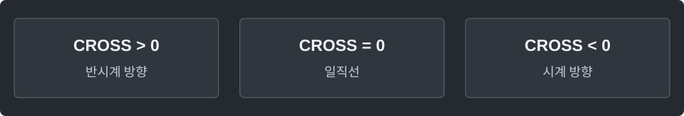

---
tags:
  - geometry
cssclasses:
  - algorithm-reference-sample
code-styler-ignore: true
---

# CCW and Segment Intersection

> [!reference] 개념과 사용 조건
> **목적** · 세 점의 방향과 두 선분의 교차 판정.
>
> **조건** · 정수 좌표, 각 좌표의 절댓값 ≤ 10⁹. 이 범위에서는 외적을 long으로 계산할 수 있다.
>
> **교차** · 끝점 접촉·일직선 겹침·길이 0인 선분도 포함. O(1).

---

## Template

세 점이 어느 방향으로 꺾이는지와 두 선분이 만나는지를 판정한다.

**Structure**

<pre class="algorithm-code" data-language="text"><code>ccw(a, b, c) {
    // (b−a) × (c−a)의 부호
    return −1 또는 0 또는 1;
}

intersects(a, b, c, d) {
    // 상대 선분의 양끝이 각 직선의 어느 쪽인지 판정
    if (두 선분이 일직선이면) {
        return x 범위와 y 범위가 모두 겹침;
    }
    return 양쪽 모두 상대 선분이 직선을 가로지름;
}</code></pre>

**Java**

<pre class="algorithm-code" data-language="java"><code>static class Point {
    final long x, y;

    Point(long x, long y) {
        this.x = x;
        this.y = y;
    }
}

static int ccw(Point a, Point b, Point c) {
    long cross = (b.x - a.x) * (c.y - a.y) - (b.y - a.y) * (c.x - a.x);
    return Long.compare(cross, 0);    // 외적끼리 곱하면 overflow: 부호만 반환
}

static boolean intersects(Point a, Point b, Point c, Point d) {
    int abc = ccw(a, b, c), abd = ccw(a, b, d);
    int cda = ccw(c, d, a), cdb = ccw(c, d, b);

    if (abc == 0 &amp;&amp; abd == 0 &amp;&amp; cda == 0 &amp;&amp; cdb == 0) {
        boolean overlapX = Math.max(Math.min(a.x, b.x), Math.min(c.x, d.x))
                &lt;= Math.min(Math.max(a.x, b.x), Math.max(c.x, d.x));
        boolean overlapY = Math.max(Math.min(a.y, b.y), Math.min(c.y, d.y))
                &lt;= Math.min(Math.max(a.y, b.y), Math.max(c.y, d.y));
        return overlapX &amp;&amp; overlapY;    // 일직선이어도 서로 떨어져 있을 수 있음
    }
    return abc * abd &lt;= 0 &amp;&amp; cda * cdb &lt;= 0;
}</code></pre>
