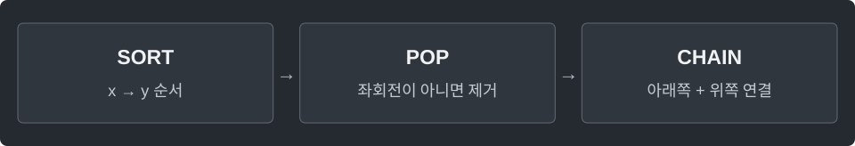

---
tags:
  - geometry
cssclasses:
  - algorithm-reference-sample
code-styler-ignore: true
---

# Convex Hull

> [!reference] 개념과 사용 조건
> **목적** · 모든 점을 포함하는 가장 작은 볼록 다각형의 꼭짓점.
>
> **조건** · 정수 좌표, 각 좌표의 절댓값 ≤ 10⁹. 중복 점은 제거한다.
>
> **반환** · 반시계 순서, 시작점 중복 없음. 변 위의 중간 점은 제외하며 전부 일직선이면 양끝만 반환.
>
> **비용** · O(n log n), 공간 O(n). 빈 입력·한 점도 처리한다.

---

## Monotone Chain

모든 점을 둘러싸는 가장 작은 볼록 다각형의 꼭짓점을 반시계 순서로 구한다.

**Structure**

<pre class="algorithm-code" data-language="text"><code>// x, y 순서 정렬 → 중복 제거
for (왼쪽부터 각 점) {
    while (마지막 두 점과 새 점이 좌회전하지 않으면) { /* 마지막 점 제거 */ }
    // 아래쪽 껍질에 새 점 추가
}

for (오른쪽부터 각 점) {
    while (위쪽 껍질이 좌회전하지 않으면) { /* 마지막 점 제거 */ }
    // 위쪽 껍질에 새 점 추가
}
return 중복된 시작점을 뺀 껍질;</code></pre>

**Java**

<pre class="algorithm-code" data-language="java"><code>static class Point {
    final long x, y;

    Point(long x, long y) {
        this.x = x;
        this.y = y;
    }
}

static long cross(Point a, Point b, Point c) {
    return (b.x - a.x) * (c.y - a.y) - (b.y - a.y) * (c.x - a.x);
}

static Point[] convexHull(Point[] input) {
    Point[] sorted = input.clone();
    Arrays.sort(sorted, Comparator.comparingLong((Point p) -&gt; p.x)
            .thenComparingLong(p -&gt; p.y));

    List&lt;Point&gt; points = new ArrayList&lt;&gt;();
    for (Point point : sorted) {
        if (points.isEmpty() || point.x != points.get(points.size() - 1).x
                || point.y != points.get(points.size() - 1).y) {
            points.add(point);
        }
    }
    int n = points.size();
    if (n &lt;= 1) return points.toArray(new Point[0]);

    Point[] hull = new Point[2 * n];
    int size = 0;
    for (Point point : points) {
        while (size &gt;= 2 &amp;&amp; cross(hull[size - 2], hull[size - 1], point) &lt;= 0) {
            size--;    // 일직선의 중간 점까지 제거하려고 &lt;= 사용
        }
        hull[size++] = point;
    }

    int lowerSize = size;
    for (int i = n - 2; i &gt;= 0; i--) {
        Point point = points.get(i);
        while (size &gt; lowerSize &amp;&amp; cross(hull[size - 2], hull[size - 1], point) &lt;= 0) {
            size--;    // 아래쪽 껍질을 지우지 않고 위쪽만 검사
        }
        hull[size++] = point;
    }
    return Arrays.copyOf(hull, size - 1);    // 마지막에 다시 넣은 시작점 제외
}</code></pre>

[[CCW and Segment Intersection]]
