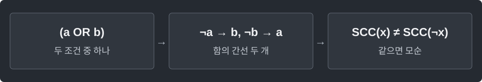

---
tags:
  - graphs
cssclasses:
  - algorithm-reference-sample
code-styler-ignore: true
---

# 2-SAT

> [!reference] 개념과 사용 조건
> **목적** · 두 literal의 OR로 된 조건들을 모두 만족하는 참·거짓 배정.
>
> **표현** · 변수 `v`는 참 `2*v`, 거짓 `2*v+1`. 반대 literal은 `^1`.
>
> **사용** · `new TwoSat(n)` → `addClause(a, aTrue, b, bTrue)` → `solve()`. 불가능하면 `null`.
>
> **비용·조건** · 변수 n, 절 m일 때 `O(n+m)`. 두 SCC 탐색 모두 명시적 스택 사용.

---

## Template

두 literal의 OR로 된 조건들을 모두 만족하는 참·거짓 배정을 구한다.

`(x0 OR NOT x1)`은 `addClause(0, true, 1, false)`. `x0`을 참으로 고정하려면 같은 literal을 두 번 넣는다.

**Structure**

<pre class="algorithm-code" data-language="text"><code>void addClause(a, b) {
    // NOT a → b, NOT b → a
}

boolean[] solve() {
    // 원본을 스택 DFS: 간선 커서 보존, pop할 때 완료 순서 기록
    // 완료 순서의 역순으로 역방향 스택 DFS: SCC 배정
    for (각 변수) {
        if (참과 거짓이 같은 SCC면) return null;
        // SCC의 위상 순서로 참/거짓 선택
    }
    return result;
}</code></pre>

**Java**

<pre class="algorithm-code" data-language="java"><code>static class TwoSat {
    final int n;
    final List&lt;List&lt;Integer&gt;&gt; graph = new ArrayList&lt;&gt;();
    final List&lt;List&lt;Integer&gt;&gt; reverse = new ArrayList&lt;&gt;();

    TwoSat(int n) {
        this.n = n;
        for (int i = 0; i &lt; 2 * n; i++) {
            graph.add(new ArrayList&lt;&gt;());
            reverse.add(new ArrayList&lt;&gt;());
        }
    }

    void imply(int from, int to) {
        graph.get(from).add(to);
        reverse.get(to).add(from);
    }

    void addClause(int a, boolean aTrue, int b, boolean bTrue) {
        int x = 2 * a + (aTrue ? 0 : 1);
        int y = 2 * b + (bTrue ? 0 : 1);
        imply(x ^ 1, y);    // (x OR y)는 NOT x → y, NOT y → x
        imply(y ^ 1, x);
    }

    boolean[] solve() {
        boolean[] visited = new boolean[2 * n];
        List&lt;Integer&gt; order = new ArrayList&lt;&gt;();
        int[] next = new int[2 * n];
        for (int vertex = 0; vertex &lt; 2 * n; vertex++) {
            if (!visited[vertex]) finishDfs(vertex, visited, order, next);
        }
        int[] component = new int[2 * n];
        Arrays.fill(component, -1);
        int componentId = 0;
        for (int i = order.size() - 1; i &gt;= 0; i--) {
            int vertex = order.get(i);
            if (component[vertex] == -1) assignDfs(vertex, componentId++, component);
        }
        boolean[] result = new boolean[n];
        for (int v = 0; v &lt; n; v++) {
            if (component[2 * v] == component[2 * v + 1]) return null;
            result[v] = component[2 * v] &gt; component[2 * v + 1];    // 이 Kosaraju 번호는 source → sink
        }
        return result;
    }

    void finishDfs(int start, boolean[] visited, List&lt;Integer&gt; order, int[] next) {
        Deque&lt;Integer&gt; stack = new ArrayDeque&lt;&gt;();
        visited[start] = true;
        stack.push(start);
        while (!stack.isEmpty()) {
            int vertex = stack.peek();
            if (next[vertex] &lt; graph.get(vertex).size()) {
                int to = graph.get(vertex).get(next[vertex]++);    // 자식 탐색 뒤에도 간선 커서를 보존
                if (!visited[to]) {
                    visited[to] = true;
                    stack.push(to);
                }
            } else {
                order.add(stack.pop());
            }
        }
    }

    void assignDfs(int start, int componentId, int[] component) {
        Deque&lt;Integer&gt; stack = new ArrayDeque&lt;&gt;();
        component[start] = componentId;
        stack.push(start);
        while (!stack.isEmpty()) {
            int vertex = stack.pop();
            for (int to : reverse.get(vertex)) {
                if (component[to] != -1) continue;
                component[to] = componentId;
                stack.push(to);
            }
        }
    }
}</code></pre>

[[SCC]]
