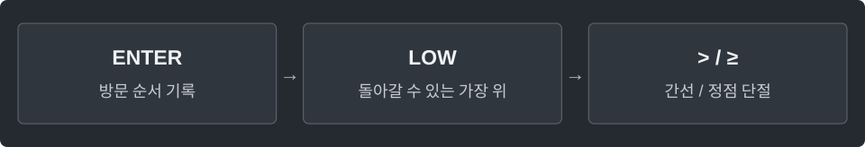

---
tags:
  - graphs
cssclasses:
  - algorithm-reference-sample
code-styler-ignore: true
---

# Bridges and Articulation Points

> [!reference] 개념과 사용 조건
> **목적** · 무방향 그래프에서 제거하면 연결 성분 수가 늘어나는 간선·정점.
>
> **기억** · Bridge는 `low[child] > entered[parent]`. 일반 정점의 Cut 조건은 `≥`.
>
> **예외** · DFS 루트는 자식이 2개 이상일 때만 단절점. `low`는 조상으로 돌아갈 수 있는 최소 방문 번호.
>
> **사용·비용** · `new LowLink(n, edges)`의 `bridge[간선번호]`, `articulation[정점]`. `O(V+E)`. 재귀이므로 긴 DFS 경로에서는 `StackOverflowError` 가능.

---

## Low-link DFS

무방향 그래프에서 제거하면 연결 성분 수가 늘어나는 간선과 정점을 찾는다.

`edges[i]={a,b}`. 자기 루프·평행 간선·분리된 성분을 허용한다.

**Structure**

<pre class="algorithm-code" data-language="text"><code>void dfs(v, parentEdge) {
    // entered[v] = low[v] = 새 방문 번호
    for (각 간선) {
        if (들어왔던 간선이면) continue;
        if (미방문 이웃이면) {
            // 자식 탐색 → low 갱신
            if (자식 low &gt; 내 방문 번호면) { /* bridge */ }
            if (루트가 아니고 자식 low ≥ 내 방문 번호면) { /* articulation */ }
        } else {
            // 이웃 방문 번호로 low 갱신
        }
    }
    if (루트이고 DFS 자식이 2개 이상이면) { /* articulation */ }
}</code></pre>

**Java**

<pre class="algorithm-code" data-language="java"><code>static class Edge {
    final int to, id;
    Edge(int to, int id) {
        this.to = to;
        this.id = id;
    }
}

static class LowLink {
    final List&lt;List&lt;Edge&gt;&gt; graph = new ArrayList&lt;&gt;();
    final int[] entered, low;
    final boolean[] bridge, articulation;
    int timer;

    LowLink(int n, int[][] edges) {
        entered = new int[n];
        low = new int[n];
        bridge = new boolean[edges.length];
        articulation = new boolean[n];
        for (int v = 0; v &lt; n; v++) graph.add(new ArrayList&lt;&gt;());
        for (int id = 0; id &lt; edges.length; id++) {
            int a = edges[id][0], b = edges[id][1];
            graph.get(a).add(new Edge(b, id));
            graph.get(b).add(new Edge(a, id));
        }
        for (int v = 0; v &lt; n; v++) {
            if (entered[v] == 0) dfs(v, -1);
        }
    }

    void dfs(int v, int parentEdge) {
        entered[v] = low[v] = ++timer;
        int children = 0;
        for (Edge edge : graph.get(v)) {
            if (edge.id == parentEdge) continue;    // 평행 간선을 부모 간선과 구별
            int to = edge.to;
            if (entered[to] == 0) {
                children++;
                dfs(to, edge.id);
                low[v] = Math.min(low[v], low[to]);
                if (<mark class="algorithm-change">low[to] &gt; entered[v]</mark>) bridge[edge.id] = true;    // v로도 돌아올 수 없음
                if (parentEdge != -1 &amp;&amp; <mark class="algorithm-change">low[to] &gt;= entered[v]</mark>) {
                    articulation[v] = true;    // v 위쪽으로 우회할 수 없음
                }
            } else {
                low[v] = Math.min(low[v], entered[to]);
            }
        }
        if (parentEdge == -1 &amp;&amp; <mark class="algorithm-change">children &gt;= 2</mark>) articulation[v] = true;
    }
}</code></pre>

[[DFS]]
