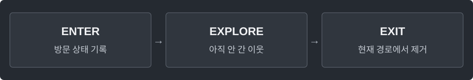

---
tags:
  - graphs
cssclasses:
  - algorithm-reference-sample
code-styler-ignore: true
---

# DFS

> [!reference] 개념과 사용 조건
> **목적** · 깊이 우선 탐색, 연결 성분과 사이클 판정.
>
> **입력** · `edges[i] = {from, to}`, 정점 `0..n-1`.
>
> **구분** · 연결 성분은 무방향. 방향 사이클은 방문 중인 정점으로 돌아오는지 본다.
>
> **비용** · `O(V+E)`. 사이클 판정은 재귀이며, 긴 DFS 경로에서는 `StackOverflowError` 가능.

---

## Connected Components

무방향 그래프의 각 정점이 속한 연결 성분 번호를 구한다.

**Structure**

<pre class="algorithm-code" data-language="text"><code>for (각 정점) {
    if (이미 방문했으면) continue;
    // 새 연결 성분의 시작점 삽입
    while (스택이 비어 있지 않으면) {
        // vertex 꺼내기 → 미방문 이웃에 같은 componentId 지정
    }
}
return component;</code></pre>

**Java**

<pre class="algorithm-code" data-language="java"><code>static int[] components(int n, int[][] edges) {
    List&lt;List&lt;Integer&gt;&gt; graph = new ArrayList&lt;&gt;(n);
    for (int vertex = 0; vertex &lt; n; vertex++) graph.add(new ArrayList&lt;&gt;());
    for (int[] row : edges) {
        graph.get(row[0]).add(row[1]);
        graph.get(row[1]).add(row[0]);
    }

    int[] component = new int[n];
    Arrays.fill(component, -1);
    Deque&lt;Integer&gt; stack = new ArrayDeque&lt;&gt;();
    int componentId = 0;
    for (int start = 0; start &lt; n; start++) {
        if (component[start] != -1) continue;
        component[start] = componentId;
        stack.push(start);
        while (!stack.isEmpty()) {
            int vertex = stack.pop();
            for (int to : graph.get(vertex)) {
                if (component[to] != -1) continue;
                component[to] = componentId;
                stack.push(to);
            }
        }
        componentId++;
    }
    return component;
}</code></pre>

---

## Directed Cycle

방향 그래프에 사이클이 있는지 판정한다.

**Structure**

<pre class="algorithm-code" data-language="text"><code>boolean cycleDfs(vertex) {
    // vertex = 방문 중
    for (각 이웃) {
        if (방문 중인 이웃이면) return true;
        if (미방문 이웃에서 사이클을 찾으면) return true;
    }
    // vertex = 방문 완료
    return false;
}</code></pre>

**Java**

<pre class="algorithm-code" data-language="java"><code>static boolean hasDirectedCycle(int n, int[][] edges) {
    List&lt;List&lt;Integer&gt;&gt; graph = new ArrayList&lt;&gt;(n);
    for (int vertex = 0; vertex &lt; n; vertex++) graph.add(new ArrayList&lt;&gt;());
    for (int[] row : edges) graph.get(row[0]).add(row[1]);

    int[] color = new int[n];
    for (int vertex = 0; vertex &lt; n; vertex++) {
        if (color[vertex] == 0 &amp;&amp; cycleDfs(vertex, graph, color)) return true;
    }
    return false;
}

static boolean cycleDfs(int vertex, List&lt;List&lt;Integer&gt;&gt; graph, int[] color) {
    color[vertex] = 1;
    for (int to : graph.get(vertex)) {
        if (color[to] == 1) return true;    // 현재 탐색 경로로 돌아가는 간선
        if (color[to] == 0 &amp;&amp; cycleDfs(to, graph, color)) return true;
    }
    color[vertex] = 2;    // 완료된 다른 경로로 가는 간선은 사이클이 아님
    return false;
}</code></pre>

---

## Undirected Cycle

무방향 그래프에 사이클이 있는지 판정한다.

**Structure**

<pre class="algorithm-code" data-language="text"><code>boolean cycleDfs(vertex, parentEdge) {
    // 방문 처리
    for (각 간선) {
        if (들어왔던 간선이면) continue;
        if (이미 방문했거나 다음 탐색에서 사이클이면) return true;
    }
    return false;
}</code></pre>

**Java**

<pre class="algorithm-code" data-language="java"><code>static class Edge {
    final int to, id;
    Edge(int to, int id) {
        this.to = to;
        this.id = id;
    }
}

static boolean hasUndirectedCycle(int n, int[][] edges) {
    List&lt;List&lt;Edge&gt;&gt; graph = new ArrayList&lt;&gt;(n);
    for (int vertex = 0; vertex &lt; n; vertex++) graph.add(new ArrayList&lt;&gt;());
    for (int id = 0; id &lt; edges.length; id++) {
        int a = edges[id][0], b = edges[id][1];
        graph.get(a).add(new Edge(b, id));
        graph.get(b).add(new Edge(a, id));
    }
    boolean[] visited = new boolean[n];
    for (int vertex = 0; vertex &lt; n; vertex++) {
        if (!visited[vertex] &amp;&amp; cycleDfs(vertex, -1, graph, visited)) return true;
    }
    return false;
}

static boolean cycleDfs(int vertex, int parentEdge, List&lt;List&lt;Edge&gt;&gt; graph,
                        boolean[] visited) {
    visited[vertex] = true;
    for (Edge edge : graph.get(vertex)) {
        if (edge.id == parentEdge) continue;    // 정점이 아닌 간선을 제외해야 평행 간선을 감지
        if (visited[edge.to]) return true;
        if (cycleDfs(edge.to, edge.id, graph, visited)) return true;
    }
    return false;
}</code></pre>

[[BFS]] · [[Topological Sort]]
