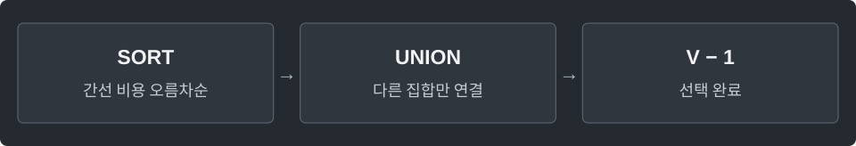

---
tags:
  - graphs
cssclasses:
  - algorithm-reference-sample
code-styler-ignore: true
---

# Kruskal

> [!reference] 개념과 사용 조건
> **목적** · 무방향 그래프의 최소 신장 트리. 음수 가중치도 가능.
>
> **입력** · 간선마다 `new Edge(a, b, weight)` 한 번만 추가. 정점 `0..n-1`.
>
> **반환** · 최소 비용 `Long`. 연결되지 않으면 `null`; 빈 그래프는 `0`.
>
> **비용** · `O(E log E)`. 평행 간선·자기 루프 허용.

---

## Template

무방향 그래프에서 모든 정점을 연결하는 최소 신장 트리의 비용을 구한다.

`List<Edge> edges = new ArrayList<>();`에 무방향 간선을 한 번씩 넣는다.

**Structure**

<pre class="algorithm-code" data-language="text"><code>// 간선 비용으로 정렬, 집합 초기화
for (싼 간선부터) {
    if (양끝이 이미 같은 집합이면) continue;
    // 합치기 → 비용 추가
    if (V-1개를 선택했으면) break;
}
return 연결 여부와 총비용;</code></pre>

**Java**

<pre class="algorithm-code" data-language="java"><code>static class Edge {
    final int from, to, weight;
    Edge(int from, int to, int weight) {
        this.from = from;
        this.to = to;
        this.weight = weight;
    }
}

static class UnionFind {
    final int[] parent, size;

    UnionFind(int n) {
        parent = new int[n];
        size = new int[n];
        for (int v = 0; v &lt; n; v++) {
            parent[v] = v;
            size[v] = 1;
        }
    }

    int find(int v) {
        while (v != parent[v]) {
            parent[v] = parent[parent[v]];    // 지나가는 경로를 짧게 만들어 다음 조회를 줄임
            v = parent[v];
        }
        return v;
    }

    boolean union(int a, int b) {
        a = find(a);
        b = find(b);
        if (a == b) return false;
        if (size[a] &lt; size[b]) {
            int temp = a;
            a = b;
            b = temp;
        }
        parent[b] = a;    // 작은 트리를 큰 트리 아래에 붙여 높이 억제
        size[a] += size[b];
        return true;
    }
}

static Long kruskal(int n, List&lt;Edge&gt; edges) {
    List&lt;Edge&gt; sorted = new ArrayList&lt;&gt;(edges);
    sorted.sort(Comparator.comparingInt(edge -&gt; edge.weight));
    UnionFind uf = new UnionFind(n);
    long total = 0;
    int used = 0;
    for (Edge edge : sorted) {
        if (!uf.union(edge.from, edge.to)) continue;    // 같은 집합을 연결하면 사이클
        total += edge.weight;
        if (++used == n - 1) break;
    }
    return used == Math.max(0, n - 1) ? total : null;
}</code></pre>

[[Union-Find]]
