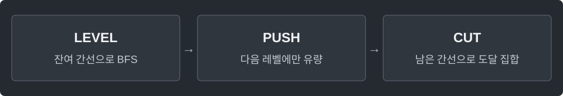

---
tags:
  - graphs
cssclasses:
  - algorithm-reference-sample
code-styler-ignore: true
---

# Max Flow and Min Cut

> [!reference] 개념과 사용 조건
> **목적** · 용량 제한 안에서 source→sink 최대 유량과 최소 절단.
>
> **입력** · `Dinic flow = new Dinic(n);` 후 `flow.addEdge(from, to, capacity)`. 용량 ≥ 0, source ≠ sink.
>
> **반환** · `maxFlow`가 잔여 용량을 변경한다. 완료 후 `sourceSide(source)`의 true/false 경계가 최소 절단.
>
> **비용·조건** · 일반 그래프 `O(V²E)`. 총유량은 `long` 범위. push는 재귀이며, 깊은 레벨 경로에서는 `StackOverflowError` 가능.

---

## Dinic

`long answer = flow.maxFlow(source, sink);` 후 `boolean[] side = flow.sourceSide(source);`. 원본 간선 중 `side[from] && !side[to]`인 간선이 절단을 이룬다.

**Structure**

<pre class="algorithm-code" data-language="text"><code>boolean buildLevel(source, sink) {
    // 잔여 용량 &gt; 0인 간선으로 BFS
}

long push(v, sink, limit) {
    if (sink에 도착했으면) return limit;
    for (아직 확인할 간선) {
        if (잔여 용량이 없거나 다음 레벨이 아니면) continue;
        // 재귀로 보낼 양 결정
        if (보냈으면) { /* 정방향 감소, 역방향 증가 */ return 보낸 양; }
    }
    return 0;
}

while (sink까지 레벨이 만들어지면) {
    // 간선 탐색 위치 초기화
    while (더 보낼 수 있으면) { /* 총유량에 추가 */ }
}</code></pre>

**Java**

<pre class="algorithm-code" data-language="java"><code>static class Edge {
    final int to, reverse;
    long capacity;

    Edge(int to, int reverse, long capacity) {
        this.to = to;
        this.reverse = reverse;
        this.capacity = capacity;
    }
}

static class Dinic {
    final List&lt;List&lt;Edge&gt;&gt; graph = new ArrayList&lt;&gt;();
    final int[] level, next;

    Dinic(int n) {
        level = new int[n];
        next = new int[n];
        for (int v = 0; v &lt; n; v++) graph.add(new ArrayList&lt;&gt;());
    }

    void addEdge(int from, int to, long capacity) {
        if (from == to) return;    // 자기 루프는 s→t 유량을 늘리지 않음
        Edge forward = new Edge(to, graph.get(to).size(), capacity);
        Edge backward = new Edge(from, graph.get(from).size(), 0);
        graph.get(from).add(forward);
        graph.get(to).add(backward);
    }

    boolean buildLevel(int source, int sink) {
        Arrays.fill(level, -1);
        Queue&lt;Integer&gt; queue = new ArrayDeque&lt;&gt;();
        level[source] = 0;
        queue.offer(source);
        while (!queue.isEmpty()) {
            int v = queue.poll();
            for (Edge edge : graph.get(v)) {
                if (edge.capacity &lt;= 0 || level[edge.to] != -1) continue;
                level[edge.to] = level[v] + 1;
                queue.offer(edge.to);
            }
        }
        return level[sink] != -1;
    }

    long push(int v, int sink, long limit) {
        if (v == sink) return limit;
        for (; next[v] &lt; graph.get(v).size(); next[v]++) {
            Edge edge = graph.get(v).get(next[v]);
            if (edge.capacity &lt;= 0 || level[edge.to] != level[v] + 1) continue;
            long sent = push(edge.to, sink, Math.min(limit, edge.capacity));
            if (sent == 0) continue;
            edge.capacity -= sent;
            graph.get(edge.to).get(edge.reverse).capacity += sent;    // 나중에 선택을 되돌릴 통로
            return sent;
        }
        return 0;
    }

    long maxFlow(int source, int sink) {
        if (source == sink) throw new IllegalArgumentException("source == sink");
        long total = 0;
        while (buildLevel(source, sink)) {
            Arrays.fill(next, 0);    // 새 레벨 그래프에서는 간선을 다시 확인
            long sent;
            while ((sent = push(source, sink, Long.MAX_VALUE)) &gt; 0) {
                total += sent;
            }
        }
        return total;
    }

    boolean[] sourceSide(int source) {
        boolean[] reached = new boolean[graph.size()];
        Queue&lt;Integer&gt; queue = new ArrayDeque&lt;&gt;();
        reached[source] = true;
        queue.offer(source);
        while (!queue.isEmpty()) {
            int v = queue.poll();
            for (Edge edge : graph.get(v)) {
                if (edge.capacity &lt;= 0 || reached[edge.to]) continue;
                reached[edge.to] = true;
                queue.offer(edge.to);
            }
        }
        return reached;
    }
}</code></pre>

[[Bipartite Matching]] · [[BFS]]
