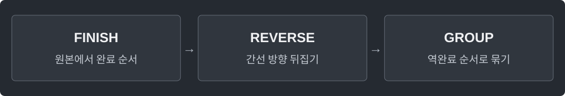

---
tags:
  - graphs
cssclasses:
  - algorithm-reference-sample
code-styler-ignore: true
---

# SCC

> [!reference] 개념과 사용 조건
> **목적** · 방향 그래프에서 서로 왕복 가능한 정점들을 하나로 묶는다.
>
> **사용** · `SCC s = new SCC(n, edges);` → `s.component[v]`, `s.count`, `s.condensation()`.
>
> **구조** · 서로 다른 SCC 사이의 간선만 남기면 DAG. 이 구현의 번호는 위상 순서.
>
> **비용·조건** · `O(V+E)`. `edges[i]={from,to}`. 두 DFS 모두 명시적 스택으로 처리.

---

## Kosaraju

**Structure**

<pre class="algorithm-code" data-language="text"><code>void finishDfs(start) {
    // 시작점을 방문 처리하고 push
    while (스택이 비어 있지 않으면) {
        if (맨 위 정점에 남은 간선이 있으면) {
            // 간선 커서 이동 → 미방문 이웃 push
        } else {
            // pop → 완료 순서에 기록
        }
    }
}

void assignDfs(start, id) {
    while (스택이 비어 있지 않으면) {
        // pop → 역방향의 미배정 이웃을 같은 SCC로 지정하고 push
    }
}

// 원본 DFS를 모두 마친 뒤
for (order의 뒤에서부터) {
    if (아직 미배정이면) { /* 역방향 DFS로 새 SCC 구성 */ }
}</code></pre>

**Java**

<pre class="algorithm-code" data-language="java"><code>static class SCC {
    final List&lt;List&lt;Integer&gt;&gt; graph = new ArrayList&lt;&gt;();
    final List&lt;List&lt;Integer&gt;&gt; reverse = new ArrayList&lt;&gt;();
    final List&lt;Integer&gt; order = new ArrayList&lt;&gt;();
    final boolean[] visited;
    final int[] component, next;
    int count;

    SCC(int n, int[][] edges) {
        visited = new boolean[n];
        component = new int[n];
        next = new int[n];
        Arrays.fill(component, -1);
        for (int v = 0; v &lt; n; v++) {
            graph.add(new ArrayList&lt;&gt;());
            reverse.add(new ArrayList&lt;&gt;());
        }
        for (int[] row : edges) {
            graph.get(row[0]).add(row[1]);
            reverse.get(row[1]).add(row[0]);
        }
        for (int v = 0; v &lt; n; v++) {
            if (!visited[v]) finishDfs(v);
        }
        for (int i = order.size() - 1; i &gt;= 0; i--) {
            int v = order.get(i);
            if (component[v] != -1) continue;
            assignDfs(v, count++);
        }
    }

    void finishDfs(int start) {
        Deque&lt;Integer&gt; stack = new ArrayDeque&lt;&gt;();
        visited[start] = true;
        stack.push(start);
        while (!stack.isEmpty()) {
            int v = stack.peek();
            if (next[v] &lt; graph.get(v).size()) {
                int to = graph.get(v).get(next[v]++);    // 자식에서 돌아오면 다음 간선부터 재개
                if (!visited[to]) {
                    visited[to] = true;
                    stack.push(to);
                }
            } else {
                order.add(stack.pop());    // 이웃 탐색이 전부 끝난 시점에 기록
            }
        }
    }

    void assignDfs(int start, int id) {
        Deque&lt;Integer&gt; stack = new ArrayDeque&lt;&gt;();
        component[start] = id;
        stack.push(start);
        while (!stack.isEmpty()) {
            int v = stack.pop();
            for (int to : reverse.get(v)) {
                if (component[to] != -1) continue;
                component[to] = id;
                stack.push(to);
            }
        }
    }

    List&lt;List&lt;Integer&gt;&gt; condensation() {
        List&lt;List&lt;Integer&gt;&gt; dag = new ArrayList&lt;&gt;(count);
        for (int id = 0; id &lt; count; id++) dag.add(new ArrayList&lt;&gt;());
        Set&lt;Long&gt; used = new HashSet&lt;&gt;();
        for (int v = 0; v &lt; graph.size(); v++) {
            for (int to : graph.get(v)) {
                int a = component[v], b = component[to];
                if (a == b) continue;
                long key = ((long) a &lt;&lt; 32) | (b &amp; 0xffffffffL);
                if (used.add(key)) dag.get(a).add(b);
            }
        }
        return dag;
    }
}</code></pre>

[[2-SAT]] · [[DAG DP]]
