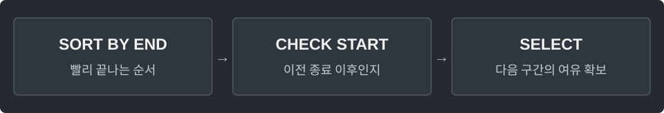

---
tags:
  - intervals
cssclasses:
  - algorithm-reference-sample
code-styler-ignore: true
---

# Interval Scheduling

> [!reference] 개념과 사용 조건
> **목적** · 겹치지 않는 구간을 최대 개수 선택.
>
> **조건** · start ≤ end. 끝나는 시각에 다음 구간 시작 가능. 구간별 가치가 다르면 이 규칙으로 최대 가치를 구할 수 없다.
>
> **비용** · 시간 O(n log n), 입력 복사·결과 공간 O(n).

---

## Template

**Structure**

<pre class="algorithm-code" data-language="text"><code>// 종료 시각 오름차순 정렬
for (각 구간) {
    if (start &gt;= 이전 선택의 end) {
        // 선택하고 end 갱신
    }
}
return selected;</code></pre>

**Java**

<pre class="algorithm-code" data-language="java"><code>static class Interval {
    final long start, end;

    Interval(long start, long end) {
        this.start = start;
        this.end = end;
    }
}

static List&lt;Interval&gt; selectIntervals(Interval[] input) {
    Interval[] intervals = input.clone();
    Arrays.sort(intervals, Comparator.comparingLong((Interval interval) -&gt; interval.end)
            .thenComparingLong(interval -&gt; interval.start));    // 종료 동률이면 길이 0인 구간을 나중에 선택
    List&lt;Interval&gt; selected = new ArrayList&lt;&gt;();
    long end = Long.MIN_VALUE;

    for (Interval interval : intervals) {
        if (interval.start &gt;= end) {
            selected.add(interval);
            end = interval.end;    // 빨리 끝낼수록 이후 선택지를 더 많이 남김
        }
    }
    return selected;
}</code></pre>

[[Sorting and Comparator]] · [[Sweep Line]]
