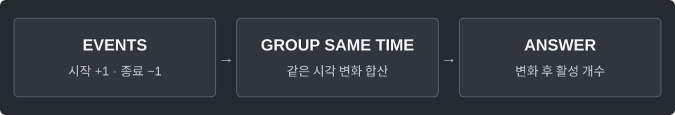

---
tags:
  - intervals
cssclasses:
  - algorithm-reference-sample
code-styler-ignore: true
---

# Sweep Line

> [!reference] 개념과 사용 조건
> **목적** · 동시에 활성인 구간의 최대 개수.
>
> **조건** · 반열린 구간 `[start, end)`, start < end. 종료 시각과 다음 시작 시각은 겹치지 않는다.
>
> **비용** · 이벤트 2n개 정렬. 시간 O(n log n), 공간 O(n).

---

## Maximum Overlap

반열린 구간 [start, end)가 동시에 가장 많이 겹치는 순간의 구간 개수를 구한다.

**Structure**

<pre class="algorithm-code" data-language="text"><code>// 시작·종료 이벤트 생성 → 시각순 정렬
while (이벤트가 남았으면) {
    // 같은 시각의 변화 전부 적용
    // answer: 활성 개수 최댓값
}
return answer;</code></pre>

**Java**

<pre class="algorithm-code" data-language="java"><code>static class Event {
    final long time;
    final int delta;

    Event(long time, int delta) {
        this.time = time;
        this.delta = delta;
    }
}

static int maxOverlap(long[][] intervals) {
    List&lt;Event&gt; events = new ArrayList&lt;&gt;();
    for (long[] interval : intervals) {
        events.add(new Event(interval[0], 1));
        events.add(new Event(interval[1], -1));
    }
    events.sort(Comparator.comparingLong(event -&gt; event.time));
    int i = 0, active = 0, answer = 0;

    while (i &lt; events.size()) {
        long time = events.get(i).time;
        while (i &lt; events.size() &amp;&amp; events.get(i).time == time) {
            active += events.get(i++).delta;
        }
        answer = Math.max(answer, active);    // 같은 시각의 종료·시작을 중간에 세지 않음
    }
    return answer;
}</code></pre>

[[Difference Array]] · [[Interval Scheduling]]
