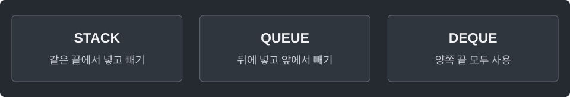

---
tags:
  - java
cssclasses:
  - algorithm-reference-sample
code-styler-ignore: true
---

# ArrayDeque

> [!reference] 개념과 사용 조건
> **목적** · Java의 Stack·Queue·Deque를 ArrayDeque로 사용.
>
> **조건** · null 저장 불가. 비었을 때 poll/peek는 null, pop/remove는 예외.
>
> **비용** · 양끝 삽입·삭제는 분할상환 O(1). 중간 원소 검색·삭제는 O(n).

---

## Stack · LIFO

마지막에 넣은 값을 먼저 꺼낸다.

**Structure**

<pre class="algorithm-code" data-language="text"><code>// push → 마지막에 넣은 것을 pop</code></pre>

**Java**

<pre class="algorithm-code" data-language="java"><code>Deque&lt;Integer&gt; stack = new ArrayDeque&lt;&gt;();
stack.push(10);
stack.push(20);
int top = stack.peek();
int removed = stack.pop();
boolean empty = stack.isEmpty();</code></pre>

---

## Queue · FIFO

먼저 넣은 값을 먼저 꺼낸다.

**Structure**

<pre class="algorithm-code" data-language="text"><code>// offerLast → 먼저 넣은 것을 pollFirst</code></pre>

**Java**

<pre class="algorithm-code" data-language="java"><code>Deque&lt;Integer&gt; queue = new ArrayDeque&lt;&gt;();
queue.offerLast(10);
queue.offerLast(20);
Integer first = queue.peekFirst();
Integer removed = queue.pollFirst();    // 빈 큐까지 허용하면 Integer로 null 보존</code></pre>

---

## Deque

앞뒤 양쪽에서 값을 넣고 꺼낸다.

**Structure**

<pre class="algorithm-code" data-language="text"><code>// 앞·뒤 중 필요한 끝을 선택</code></pre>

**Java**

<pre class="algorithm-code" data-language="java"><code>Deque&lt;Integer&gt; deque = new ArrayDeque&lt;&gt;();
deque.offerFirst(10);
deque.offerLast(20);
Integer front = deque.pollFirst();
Integer back = deque.pollLast();</code></pre>

[[BFS]] · [[Monotonic Stack]] · [[Monotonic Deque]]
