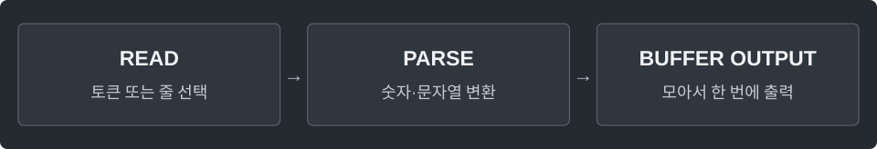

---
tags:
  - java
cssclasses:
  - algorithm-reference-sample
code-styler-ignore: true
---

# Fast Input and Output

> [!reference] 개념과 사용 조건
> **목적** · 숫자·토큰 입력이 많을 때 바이트 버퍼 사용. 공백을 포함한 문장은 readLine.
>
> **조건** · FastScanner는 ASCII 토큰 입력. 정수는 Java long 범위, nextInt는 int 범위.
>
> **반환** · next()는 EOF에서 null, 숫자 입력은 EOFException. 출력은 StringBuilder로 누적.

---

## FastScanner

공백으로 구분된 정수와 문자열을 버퍼로 빠르게 읽는다.

필요한 import: `java.io.*`. 입력은 유효한 정수 토큰이라고 가정한다.

**Structure**

<pre class="algorithm-code" data-language="text"><code>class FastScanner {
    read()       // 버퍼가 비면 다시 채움
    next()       // 공백을 건너뛰고 토큰 읽기
    nextLong()   // 부호 처리 후 자릿수 누적
    nextInt()    // long 결과를 int 범위로 변환
}</code></pre>

**Java**

<pre class="algorithm-code" data-language="java"><code>static class FastScanner {
    final InputStream in;
    final byte[] buffer = new byte[1 &lt;&lt; 16];
    int pos, size;

    FastScanner(InputStream in) {
        this.in = in;
    }

    int read() throws IOException {
        if (pos &gt;= size) {
            size = in.read(buffer);
            pos = 0;
            if (size &lt;= 0) return -1;
        }
        return buffer[pos++] &amp; 0xff;
    }

    String next() throws IOException {
        int c;
        do { c = read(); } while (c != -1 &amp;&amp; c &lt;= ' ');
        if (c == -1) return null;
        StringBuilder value = new StringBuilder();
        while (c &gt; ' ') {
            value.append((char) c);
            c = read();
        }
        return value.toString();
    }

    long nextLong() throws IOException {
        int c;
        do { c = read(); } while (c != -1 &amp;&amp; c &lt;= ' ');
        if (c == -1) throw new EOFException();
        boolean negative = c == '-';
        if (c == '-' || c == '+') c = read();
        long value = 0;
        while (c &gt; ' ') {
            value = value * 10 - (c - '0');    // 음수로 누적하면 Long.MIN_VALUE도 표현 가능
            c = read();
        }
        return negative ? value : -value;
    }

    int nextInt() throws IOException {
        return Math.toIntExact(nextLong());
    }
}</code></pre>

---

## Use

정수 n개를 읽어 한 줄에 하나씩 모아서 출력한다.

**Structure**

<pre class="algorithm-code" data-language="text"><code>// scanner 생성 → 필요한 값 읽기
// 결과를 모아서 출력</code></pre>

**Java**

<pre class="algorithm-code" data-language="java"><code>FastScanner scanner = new FastScanner(System.in);
int n = scanner.nextInt();
StringBuilder output = new StringBuilder();
for (int i = 0; i &lt; n; i++) {
    long value = scanner.nextLong();
    output.append(value).append('\n');
}
System.out.print(output);</code></pre>

---

## Read a Whole Line

공백이 포함된 한 줄을 읽고, 필요하면 토큰으로 나눈다.

한 실행에서는 필요한 입력 방식 하나를 선택한다. 같은 System.in을 여러 버퍼로 동시에 읽지 않는다.

**Structure**

<pre class="algorithm-code" data-language="text"><code>// 줄 전체를 읽고 필요할 때 토큰으로 분리</code></pre>

**Java**

<pre class="algorithm-code" data-language="java"><code>BufferedReader reader = new BufferedReader(new InputStreamReader(System.in));
String line = reader.readLine();
if (line != null) {
    StringTokenizer tokens = new StringTokenizer(line);
    while (tokens.hasMoreTokens()) {
        String token = tokens.nextToken();
    }
}</code></pre>
