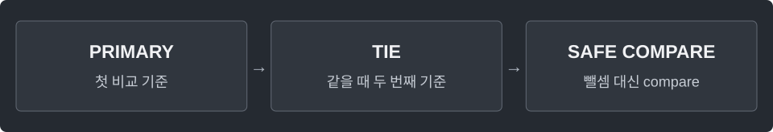

---
tags:
  - java
cssclasses:
  - algorithm-reference-sample
code-styler-ignore: true
---

# Sorting and Comparator

> [!reference] 개념과 사용 조건
> **목적** · 기본형 배열 정렬과 객체의 다중 기준 정렬.
>
> **조건** · Comparator는 일관된 순서를 반환해야 한다. 객체 비교에 필드 뺄셈을 쓰지 않는다.
>
> **비용** · 일반 정렬 O(n log n). sort는 전달한 배열·리스트의 순서를 바꾼다.

---

## Primitive Array

정수 배열을 오름차순으로 정렬한 뒤 뒤집어 내림차순으로 만든다.

**Structure**

<pre class="algorithm-code" data-language="text"><code>// 오름차순 정렬
// 내림차순이 필요하면 뒤집기</code></pre>

**Java**

<pre class="algorithm-code" data-language="java"><code>int[] values = {5, 1, 3};
Arrays.sort(values);
for (int left = 0, right = values.length - 1; left &lt; right; left++, right--) {
    int temp = values[left];
    values[left] = values[right];
    values[right] = temp;
}</code></pre>

---

## Objects

점수는 내림차순, 동점이면 id는 오름차순으로 정렬한다.

**Structure**

<pre class="algorithm-code" data-language="text"><code>// score 내림차순
// 같은 score면 id 오름차순</code></pre>

**Java**

<pre class="algorithm-code" data-language="java"><code>static class Item {
    final int id, score;

    Item(int id, int score) {
        this.id = id;
        this.score = score;
    }
}

static void sortItems(List&lt;Item&gt; items) {
    items.sort(Comparator.comparingInt((Item item) -&gt; item.score)
            .reversed()    // 첫 기준만 뒤집고 나서 두 번째 기준을 붙임
            .thenComparingInt(item -&gt; item.id));
}</code></pre>

[[PriorityQueue]] · [[Interval Scheduling]]
