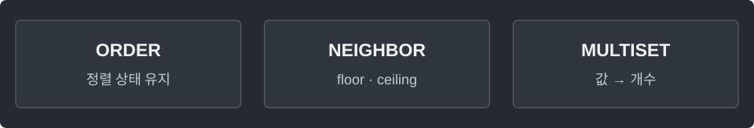

---
tags:
  - java
cssclasses:
  - algorithm-reference-sample
code-styler-ignore: true
---

# TreeMap and TreeSet

> [!reference] 개념과 사용 조건
> **목적** · 값의 순서와 이웃 조회가 필요한 집합·중복 집합.
>
> **경계** · lower < x, floor ≤ x, ceiling ≥ x, higher > x. 해당 값이 없으면 null.
>
> **비용** · 삽입·삭제·이웃 조회 O(log n). TreeSet은 같은 값을 하나만 보관.

---

## Ordered Set

**Structure**

<pre class="algorithm-code" data-language="text"><code>// 값 삽입
// x 이하의 최댓값 / x 이상의 최솟값 조회</code></pre>

**Java**

<pre class="algorithm-code" data-language="java"><code>NavigableSet&lt;Integer&gt; set = new TreeSet&lt;&gt;();
set.add(10);
set.add(20);
Integer floor = set.floor(15);
Integer ceiling = set.ceiling(15);
Integer lower = set.lower(10);
set.remove(10);</code></pre>

---

## Multiset

**Structure**

<pre class="algorithm-code" data-language="text"><code>add(value) {
    // 빈도 증가
}
remove(value) {
    // 빈도 감소, 0이면 키 제거
}
min() / max() {
    // 첫 키 / 마지막 키
}</code></pre>

**Java**

<pre class="algorithm-code" data-language="java"><code>static class Multiset {
    final TreeMap&lt;Integer, Integer&gt; count = new TreeMap&lt;&gt;();

    void add(int value) {
        count.merge(value, 1, Integer::sum);
    }

    boolean remove(int value) {
        Integer frequency = count.get(value);
        if (frequency == null) return false;
        if (frequency == 1) count.remove(value);
        else count.put(value, frequency - 1);
        return true;
    }

    Integer min() {
        return count.isEmpty() ? null : count.firstKey();
    }

    Integer max() {
        return count.isEmpty() ? null : count.lastKey();
    }

    Integer floor(int value) {
        return count.floorKey(value);
    }

    Integer ceiling(int value) {
        return count.ceilingKey(value);
    }
}</code></pre>

[[HashMap and HashSet]] · [[PriorityQueue]]
