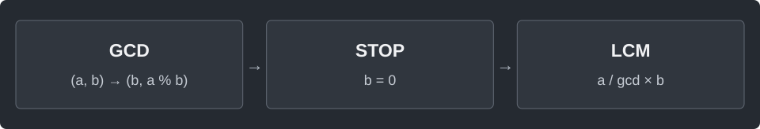

---
tags:
  - math
cssclasses:
  - algorithm-reference-sample
code-styler-ignore: true
---

# GCD and LCM

> [!reference] 개념과 사용 조건
> **목적** · 최대공약수와 최소공배수.
>
> **조건** · a, b는 0 이상의 long. gcd(0, 0) = 0, 한쪽이 0이면 lcm = 0.
>
> **비용** · GCD O(log min(a, b)), 공간 O(1). LCM이 long을 넘으면 예외를 낸다.

---

## Template

두 수 a, b의 최대공약수와 최소공배수를 구한다.

**Structure**

<pre class="algorithm-code" data-language="text"><code>gcd(a, b) {
    while (b가 0이 아니면) {
        // 나머지 계산 → (b, 나머지)로 이동
    }
    return a;
}

lcm(a, b) {
    if (어느 한쪽이 0이면) return 0;
    return a를 gcd로 나눈 뒤 b를 곱한 값;
}</code></pre>

**Java**

<pre class="algorithm-code" data-language="java"><code>static long gcd(long a, long b) {
    while (b != 0) {
        long remainder = a % b;
        a = b;
        b = remainder;
    }
    return a;
}

static long lcm(long a, long b) {
    if (a == 0 || b == 0) return 0;
    return Math.multiplyExact(a / gcd(a, b), b);    // 먼저 나눠 중간 곱의 overflow 방지
}</code></pre>
