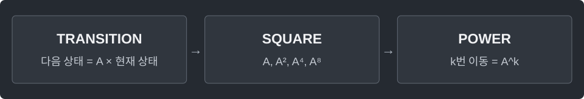

---
tags:
  - math
cssclasses:
  - algorithm-reference-sample
code-styler-ignore: true
---

# Matrix Exponentiation

> [!reference] 개념과 사용 조건
> **목적** · 같은 선형 전이를 매우 많이 반복할 때 전이 행렬을 거듭제곱.
>
> **조건** · 정사각 행렬, exponent ≥ 0, 2 ≤ mod ≤ Integer.MAX_VALUE.
>
> **반환·비용** · A^exponent mod mod. 지수 0이면 단위행렬. d×d 행렬은 O(d³ log exponent).

---

## Template

행렬 곱의 입력은 0..mod−1로 정규화된 값. matrixPower는 입력을 복사하면서 정규화한다.

**Structure**

<pre class="algorithm-code" data-language="text"><code>multiply(a, b) {
    for (출발 행 i) {
        for (중간 인덱스 k) {
            for (도착 열 j) { /* a[i][k] × b[k][j] 누적 */ }
        }
    }
    return 결과 행렬;
}

matrixPower(a, exponent) {
    // 결과 = 단위행렬
    while (exponent &gt; 0) {
        if (현재 비트가 1이면) { /* 결과 × a */ }
        // a 제곱 → 다음 비트
    }
    return 결과;
}</code></pre>

**Java**

<pre class="algorithm-code" data-language="java"><code>static long[][] multiply(long[][] a, long[][] b, int mod) {
    int n = a.length;
    long[][] result = new long[n][n];
    for (int i = 0; i &lt; n; i++) {
        for (int k = 0; k &lt; n; k++) {
            for (int j = 0; j &lt; n; j++) {
                result[i][j] = (result[i][j] + a[i][k] * b[k][j]) % mod;
            }
        }
    }
    return result;
}

static long[][] matrixPower(long[][] matrix, long exponent, int mod) {
    int n = matrix.length;
    long[][] result = new long[n][n], base = new long[n][n];
    for (int i = 0; i &lt; n; i++) {
        result[i][i] = 1;    // 지수 0에도 행렬 곱의 항등원 반환
        for (int j = 0; j &lt; n; j++) {
            base[i][j] = Math.floorMod(matrix[i][j], (long) mod);
        }
    }

    while (exponent &gt; 0) {
        if ((exponent &amp; 1) != 0) result = multiply(result, base, mod);
        base = multiply(base, base, mod);
        exponent &gt;&gt;= 1;
    }
    return result;
}</code></pre>

[[Modular Arithmetic]]
