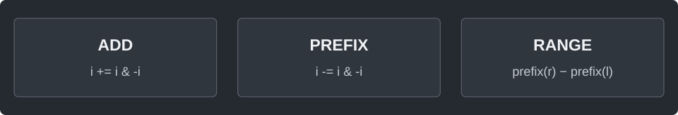

---
tags:
  - ranges
cssclasses:
  - algorithm-reference-sample
code-styler-ignore: true
---

# Fenwick Tree

> [!reference] 개념과 사용 조건
> **목적** · 값이 바뀌는 배열의 누적합·구간 합.
>
> **범위** · 바깥 인덱스는 0-based. `add/set`은 `0..n-1`, `sum`은 `[left, right)`.
>
> **핵심** · 내부만 1-based. `i & -i`는 현재 블록의 길이.
>
> **비용** · 생성 O(n log n), 갱신·질의 O(log n). 합은 long 범위.

---

## Template

원소의 값을 더하거나 바꾸면서 누적합과 구간 합을 구한다.

**Structure**

<pre class="algorithm-code" data-language="text"><code>add(index, delta) {
    while (배열 안이면) {
        // 이 값을 포함하는 블록 갱신 → 상위 블록
    }
}

prefix(end) {
    while (남은 prefix가 있으면) {
        // 끝 블록 더하기 → 그 블록 제거
    }
}

sum(left, right) {
    return prefix(right) - prefix(left);
}</code></pre>

**Java**

<pre class="algorithm-code" data-language="java"><code>static class Fenwick {
    final int n;
    final long[] tree;

    Fenwick(long[] values) {
        n = values.length;
        tree = new long[n + 1];
        for (int i = 0; i &lt; n; i++) {
            add(i, values[i]);
        }
    }

    void add(int index, long delta) {
        for (int i = index + 1; i &lt;= n; i += i &amp; -i) {    // 0에서는 lowbit이 0이라 이동 불가
            tree[i] += delta;
        }
    }

    long prefix(int end) {
        long answer = 0;
        for (int i = end; i &gt; 0; i -= i &amp; -i) {
            answer += tree[i];
        }
        return answer;
    }

    long sum(int left, int right) {
        return prefix(right) - prefix(left);
    }

    void set(int index, long value) {
        add(index, value - sum(index, index + 1));    // 저장값 자체가 아니라 변화량 반영
    }
}</code></pre>

[[Prefix Sum]] · [[Segment Tree]]
