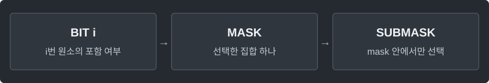

---
tags:
  - search
cssclasses:
  - algorithm-reference-sample
code-styler-ignore: true
---

# Bitmask

> [!reference] 개념과 사용 조건
> **목적** · 작은 집합을 정수 하나로 표현.
>
> **조건** · int 비트 연산은 원소 번호 `0..29`. 전체 부분집합 생성은 여기서 `n ≤ 20`.
>
> **구분** · 비트마스크는 상태 표현. 그 상태 사이 최적값을 전달하면 Bitmask DP.

---

## Set Operations

**Structure**

<pre class="algorithm-code" data-language="text"><code>add(mask, i)      // i번 비트를 1로
remove(mask, i)   // i번 비트만 0으로
contains(mask, i) // i번 비트가 1인지
count(mask)      // 포함된 원소 수</code></pre>

**Java**

<pre class="algorithm-code" data-language="java"><code>static int add(int mask, int i) {
    return mask | (1 &lt;&lt; i);
}

static int remove(int mask, int i) {
    return mask &amp; ~(1 &lt;&lt; i);    // XOR은 없는 원소를 오히려 추가함
}

static boolean contains(int mask, int i) {
    return (mask &amp; (1 &lt;&lt; i)) != 0;
}

static int count(int mask) {
    return Integer.bitCount(mask);
}</code></pre>

---

## All Subsets

`sums[mask]`는 그 집합의 합. 빈 집합 `sums[0] = 0`. 시간·공간 O(2ⁿ).

**Structure**

<pre class="algorithm-code" data-language="text"><code>for (빈 집합 다음 mask부터) {
    // 가장 낮은 비트 하나의 위치 확인
    // 그 비트를 뺀 집합의 합에 해당 원소 추가
}
return sums;</code></pre>

**Java**

<pre class="algorithm-code" data-language="java"><code>static long[] subsetSums(int[] a) {
    if (a.length &gt; 20) throw new IllegalArgumentException();
    long[] sums = new long[1 &lt;&lt; a.length];

    for (int mask = 1; mask &lt; sums.length; mask++) {
        int bit = Integer.numberOfTrailingZeros(mask);
        sums[mask] = sums[mask &amp; (mask - 1)] + a[bit];    // 가장 낮은 1비트를 제거한 상태는 이미 계산됨
    }
    return sums;
}</code></pre>

---

## Submasks

0과 mask 자신을 포함. 시간·출력 공간 O(2ᵏ), k는 mask의 1비트 수.

**Structure**

<pre class="algorithm-code" data-language="text"><code>sub = mask;
while (true) {
    // 현재 sub 저장
    if (sub == 0) break;
    // mask에 포함된 다음 부분집합으로
}</code></pre>

**Java**

<pre class="algorithm-code" data-language="java"><code>static List&lt;Integer&gt; submasks(int mask) {
    List&lt;Integer&gt; result = new ArrayList&lt;&gt;();
    for (int sub = mask; ; sub = (sub - 1) &amp; mask) {
        result.add(sub);
        if (sub == 0) break;    // 0에서 계속하면 다시 mask로 돌아감
    }
    return result;
}</code></pre>

[[Bitmask DP]] · [[Meet in the Middle]]
