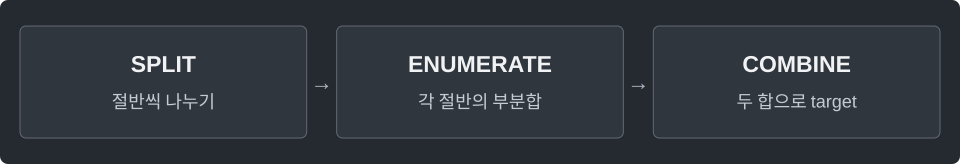

---
tags:
  - search
cssclasses:
  - algorithm-reference-sample
code-styler-ignore: true
---

# Meet in the Middle

> [!reference] 개념과 사용 조건
> **목적** · 합이 target인 부분집합 개수. 음수·중복 원소도 가능.
>
> **조건** · `int[] a`, n ≤ 40. 빈 집합 포함; 같은 값이어도 인덱스가 다르면 다른 선택.
>
> **비용** · 절반 크기 m ≈ n/2. 시간 O(m·2ᵐ), 공간 O(2ᵐ).

---

## Count Subset Sums

배열에서 합이 `target`인 부분집합의 개수를 센다.

**Structure**

<pre class="algorithm-code" data-language="text"><code>// 양쪽 부분집합 합 생성 → 각각 정렬
while (양쪽 후보가 남았으면) {
    if (합 &lt; target) {
        // 왼쪽 합을 키움
    } else if (합 &gt; target) {
        // 오른쪽 합을 줄임
    } else {
        // 같은 값의 개수끼리 곱해 answer에 추가
    }
}
return answer;</code></pre>

**Java**

<pre class="algorithm-code" data-language="java"><code>static long countSubsets(int[] a, long target) {
    if (a.length &gt; 40) throw new IllegalArgumentException();
    int mid = a.length / 2;
    long[] leftSums = halfSums(a, 0, mid);
    long[] rightSums = halfSums(a, mid, a.length);
    Arrays.sort(leftSums);
    Arrays.sort(rightSums);
    int left = 0, right = rightSums.length - 1;
    long answer = 0;

    while (left &lt; leftSums.length &amp;&amp; right &gt;= 0) {
        long sum = leftSums[left] + rightSums[right];
        if (sum &lt; target) {
            left++;
        } else if (sum &gt; target) {
            right--;
        } else {
            long leftSum = leftSums[left], rightSum = rightSums[right];
            long leftCount = 0, rightCount = 0;
            while (left &lt; leftSums.length &amp;&amp; leftSums[left] == leftSum) {
                left++;
                leftCount++;
            }
            while (right &gt;= 0 &amp;&amp; rightSums[right] == rightSum) {
                right--;
                rightCount++;
            }
            answer += leftCount * rightCount;    // 같은 합을 만드는 서로 다른 선택을 모두 셈
        }
    }
    return answer;
}

static long[] halfSums(int[] a, int from, int to) {
    long[] sums = new long[1 &lt;&lt; (to - from)];
    for (int mask = 1; mask &lt; sums.length; mask++) {
        int bit = Integer.numberOfTrailingZeros(mask);
        sums[mask] = sums[mask &amp; (mask - 1)] + a[from + bit];
    }
    return sums;
}</code></pre>

[[Bitmask]] · [[Two Pointers]]
