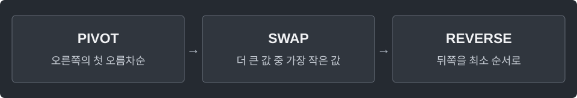

---
tags:
  - search
cssclasses:
  - algorithm-reference-sample
code-styler-ignore: true
---

# Next Permutation

> [!reference] 개념과 사용 조건
> **목적** · 현재 배열을 바로 다음 사전순 순열로 바꾼다.
>
> **반환** · 다음 순열이 있으면 true. 마지막 순열이면 오름차순으로 되돌리고 false.
>
> **조건** · 중복 값 허용. 시간 O(n), 추가 공간 O(1). 전체 열거는 정렬된 배열에서 시작.

---

## Template

배열을 바로 다음 사전순 순열로 바꾸고, 다음 순열이 있는지 반환한다.

**Structure**

<pre class="algorithm-code" data-language="text"><code>// 뒤에서부터 pivot 찾기
if (pivot이 없으면) {
    // 전체 뒤집기
    return false;
}
// 뒤에서 pivot보다 큰 첫 값과 교환
// pivot 다음 구간을 뒤집기
return true;</code></pre>

**Java**

<pre class="algorithm-code" data-language="java"><code>static boolean nextPermutation(int[] a) {
    int pivot = a.length - 2;
    while (pivot &gt;= 0 &amp;&amp; a[pivot] &gt;= a[pivot + 1]) pivot--;

    if (pivot &lt; 0) {
        reverse(a, 0, a.length - 1);
        return false;
    }

    int next = a.length - 1;
    while (a[next] &lt;= a[pivot]) next--;
    int temp = a[pivot];
    a[pivot] = a[next];
    a[next] = temp;
    reverse(a, pivot + 1, a.length - 1);    // 내림차순 suffix를 최소인 오름차순으로
    return true;
}

static void reverse(int[] a, int left, int right) {
    while (left &lt; right) {
        int temp = a[left];
        a[left++] = a[right];
        a[right--] = temp;
    }
}</code></pre>

[[Backtracking]]
