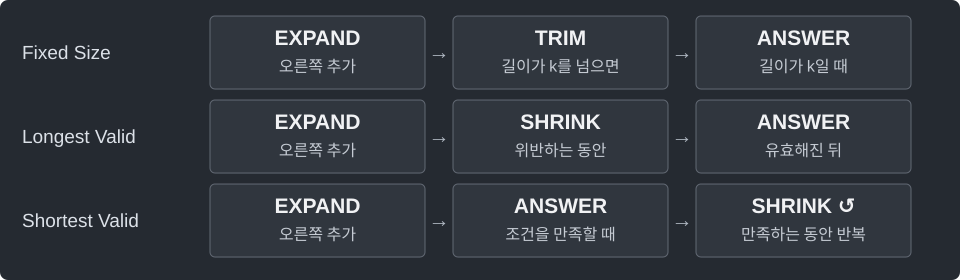

---
tags:
  - search
cssclasses:
  - algorithm-reference-sample
code-styler-ignore: true
---

# Sliding Window

> [!reference] 개념과 사용 조건
> **목적** · 연속 구간의 상태를 유지하며 양쪽 경계를 한 방향으로 이동.
>
> **핵심** · 최장 유효 구간은 위반을 없앤 뒤 기록. 최단 충족 구간은 조건이 깨지기 전에 기록.
>
> **범위** · 아래 세 변형 모두 시간 O(n). 합은 long, 빈도는 HashMap으로 유지.

---

## Fixed Size

음수가 있어도 사용 가능. 길이가 정확히 `k`인 구간만 비교한다.

**Structure**

<pre class="algorithm-code" data-language="text"><code>for (right를 처음부터 끝까지) {
    // expand
    if (길이가 k를 넘으면) {
        // 가장 왼쪽 원소 제거
    }
    if (길이가 k이면) {
        // answer
    }
}
return answer;</code></pre>

**Java**

<pre class="algorithm-code" data-language="java"><code>static long maxFixedSum(int[] a, int k) {
    if (k &lt; 1 || k &gt; a.length) throw new IllegalArgumentException();
    long sum = 0, answer = Long.MIN_VALUE;    // 음수만 있어도 빈 구간을 고르지 않음

    for (int right = 0; right &lt; a.length; right++) {
        sum += a[right];
        if (right &gt;= k) sum -= a[right - k];
        if (right &gt;= k - 1) answer = Math.max(answer, sum);
    }
    return answer;
}</code></pre>

---

## Longest Valid Window

서로 다른 값이 최대 `k`종류인 최장 구간. `k = 0`이면 0.

**Structure**

<pre class="algorithm-code" data-language="text"><code>for (right를 처음부터 끝까지) {
    // expand: 빈도 추가
    while (조건을 위반하면) {
        // shrink: 왼쪽 빈도 제거
    }
    // answer: 유효해진 구간 길이 기록
}
return answer;</code></pre>

**Java**

<pre class="algorithm-code" data-language="java"><code>static int longestAtMostKDistinct(int[] a, int k) {
    if (k &lt; 0) throw new IllegalArgumentException();
    Map&lt;Integer, Integer&gt; count = new HashMap&lt;&gt;();
    int left = 0, answer = 0;

    for (int right = 0; right &lt; a.length; right++) {
        count.merge(a[right], 1, Integer::sum);

        <mark class="algorithm-change">while</mark><mark class="algorithm-change"> (count.size() &gt; k)</mark> {
            int value = a[left++];
            int remaining = count.get(value) - 1;
            if (remaining == 0) count.remove(value);    // 0개인 값은 종류 수에서 제외
            else count.put(value, remaining);
        }
        answer = Math.max(answer, right - left + 1);
    }
    return answer;
}</code></pre>

---

## Shortest Satisfying Window

**모든 원소 ≥ 0, target > 0.** 답이 없으면 0. 음수가 있으면 이 축소 규칙은 성립하지 않는다.

**Structure**

<pre class="algorithm-code" data-language="text"><code>for (right를 처음부터 끝까지) {
    // expand: 합에 추가
    while (합이 target 이상이면) {
        // answer: 줄이기 전에 현재 길이 기록
        // shrink: 왼쪽을 제거하고 더 짧은 답 시도
    }
}
return answer;</code></pre>

**Java**

<pre class="algorithm-code" data-language="java"><code>static int shortestAtLeast(int[] a, long target) {
    if (target &lt;= 0) throw new IllegalArgumentException();
    int left = 0, answer = Integer.MAX_VALUE;
    long sum = 0;

    for (int right = 0; right &lt; a.length; right++) {
        sum += a[right];

        <mark class="algorithm-change">while</mark><mark class="algorithm-change"> (sum &gt;= target)</mark> {
            <mark class="algorithm-change">answer = Math.min(answer, right - left + 1);</mark>    // 제거하면 조건이 깨질 수 있음
            sum -= a[left++];
        }
    }
    return answer == Integer.MAX_VALUE ? 0 : answer;
}</code></pre>

[[Two Pointers]] · [[Prefix Sum with Hash Map]] · [[Monotonic Deque]]
