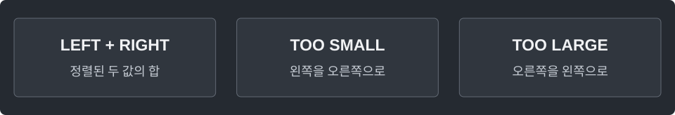

---
tags:
  - search
cssclasses:
  - algorithm-reference-sample
code-styler-ignore: true
---

# Two Pointers

> [!reference] 개념과 사용 조건
> **목적** · 서로 다른 두 원소의 합이 `target`인지 검사.
>
> **조건** · `a`는 오름차순 정렬. 정렬 비용을 제외하면 시간 O(n), 공간 O(1).
>
> **판단** · 합이 작으면 작은 값을 키우고, 합이 크면 큰 값을 줄인다.

---

## Pair Sum

**Structure**

<pre class="algorithm-code" data-language="text"><code>while (left &lt; right) {
    // 두 값의 합 계산
    if (합 == target) return true;
    if (합 &lt; target) {
        // left를 다음으로
    } else {
        // right를 이전으로
    }
}
return false;</code></pre>

**Java**

<pre class="algorithm-code" data-language="java"><code>static boolean hasPair(int[] a, long target) {
    int left = 0, right = a.length - 1;

    while (left &lt; right) {
        long sum = (long) a[left] + a[right];    // 더하기 전에 long으로 승격
        if (sum == target) return true;

        if (sum &lt; target) {
            left++;
        } else {
            right--;
        }
    }
    return false;
}</code></pre>

[[Binary Search]] · [[Sliding Window]]
