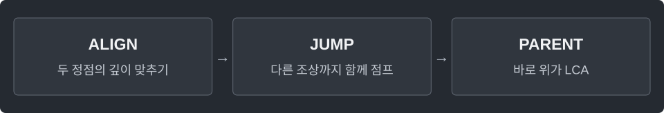

---
tags:
  - trees
cssclasses:
  - algorithm-reference-sample
code-styler-ignore: true
---

# LCA and Binary Lifting

> [!reference] 개념과 사용 조건
> **목적** · 최소 공통 조상, k번째 조상, 두 정점 사이 간선 수.
>
> **조건** · n ≥ 1인 연결된 무방향 트리. `edges[i]={a,b}`.
>
> **사용** · `LCA t = new LCA(n, edges, root);` → `query(a,b)`, `ancestor(vertex,k)`, `distance(a,b)`.
>
> **비용·반환** · 전처리 `O(V log V)`, 질의 `O(log V)`. 존재하지 않는 k번째 조상은 `-1`.

---

## Template

최소 공통 조상, k번째 조상, 두 정점 사이의 간선 수를 구한다.

**Structure**

<pre class="algorithm-code" data-language="text"><code>// BFS로 깊이와 바로 위 부모 만들기
for (각 점프 단계 k) {
    // 2^(k-1)번 위의 조상에서 다시 2^(k-1)번 이동
}

int query(a, b) {
    // 깊은 쪽을 끌어올려 깊이 맞추기
    if (같은 정점이면) return a;
    for (큰 점프부터) {
        if (점프한 조상이 서로 다르면) { /* 둘 다 위로 이동 */ }
    }
    return 바로 위 부모;
}</code></pre>

**Java**

<pre class="algorithm-code" data-language="java"><code>static class LCA {
    final int[][] up;
    final int[] depth;
    final int log;

    LCA(int n, int[][] edges, int root) {
        int levels = 1;
        while ((1L &lt;&lt; levels) &lt;= n) levels++;
        log = levels;
        up = new int[log][n];
        depth = new int[n];
        Arrays.fill(depth, -1);
        List&lt;List&lt;Integer&gt;&gt; graph = new ArrayList&lt;&gt;(n);
        for (int vertex = 0; vertex &lt; n; vertex++) graph.add(new ArrayList&lt;&gt;());
        for (int[] row : edges) {
            graph.get(row[0]).add(row[1]);
            graph.get(row[1]).add(row[0]);
        }
        Queue&lt;Integer&gt; queue = new ArrayDeque&lt;&gt;();
        up[0][root] = root;    // 루트 위로 올라도 배열 범위를 벗어나지 않음
        depth[root] = 0;
        queue.offer(root);
        while (!queue.isEmpty()) {
            int vertex = queue.poll();
            for (int to : graph.get(vertex)) {
                if (depth[to] != -1) continue;
                depth[to] = depth[vertex] + 1;
                up[0][to] = vertex;
                queue.offer(to);
            }
        }
        for (int k = 1; k &lt; log; k++) {
            for (int vertex = 0; vertex &lt; n; vertex++) {
                up[k][vertex] = up[k - 1][up[k - 1][vertex]];
            }
        }
    }

    int ancestor(int vertex, int distance) {
        if (distance &lt; 0 || distance &gt; depth[vertex]) return -1;
        for (int k = 0; k &lt; log; k++) {
            if ((distance &amp; (1 &lt;&lt; k)) != 0) vertex = up[k][vertex];
        }
        return vertex;
    }

    int query(int a, int b) {
        if (depth[a] &lt; depth[b]) {
            int temp = a;
            a = b;
            b = temp;
        }
        a = ancestor(a, depth[a] - depth[b]);
        if (a == b) return a;
        for (int k = log - 1; k &gt;= 0; k--) {
            if (up[k][a] != up[k][b]) {    // 조상이 달라야 LCA 아래에 머무름
                a = up[k][a];
                b = up[k][b];
            }
        }
        return up[0][a];
    }

    int distance(int a, int b) {
        int common = query(a, b);
        return (depth[a] - depth[common]) + (depth[b] - depth[common]);
    }
}</code></pre>

[[Rooted Tree Traversal]]
